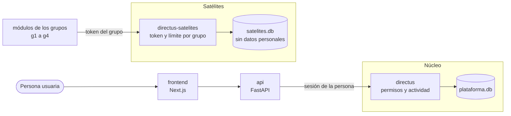

<div align="center">


# DISC Scheduling

Plataforma web de apoyo a la programación académica del Departamento de Ingeniería de Sistemas y Computación de la Universidad Católica del Norte

[](https://github.com/Capstone-2026-DISC/DISC-Scheduling/actions/workflows/ci.yml)

</div>

## Qué es

Cada semestre el Encargado Docente arma a mano la oferta académica del departamento y controla por separado el gasto en profesores hora y ayudantes. Esta plataforma guarda esos datos, aplica permisos por departamento, deja auditoría de cada cambio y servirá de base para que los grupos de Proyecto Integrador conecten sus módulos.

## Arquitectura



La API no abre `plataforma.db`: todo lo que lee o escribe del núcleo pasa por Directus. Los módulos de los grupos tampoco tocan el núcleo, hablan con su propio Directus. Lo único que la API hace sin Directus es regenerar la copia `satelites.db` (sin datos personales) que leen los módulos; esa copia no es el núcleo.

Todo usa SQLite y Directus es la única puerta a los datos: la API le habla con la sesión de cada persona, y Directus aplica los permisos por rol y departamento y registra quién cambió qué. Los módulos de los grupos leen una réplica sin datos personales y guardan lo suyo en colecciones propias.

## Despliegue

Requiere Docker con Compose v2 y Python 3 (solo para generar la configuración).

```bash
git clone https://github.com/Capstone-2026-DISC/DISC-Scheduling.git
cd DISC-Scheduling
python3 scripts/configure.py          # crea .env con claves aleatorias; no se sube al repositorio
docker compose up --build --wait
docker compose logs configurar        # debe terminar con "verificación: todo correcto"
```

Los servicios `migrar` y `configurar` corren una vez: el primero crea la base desde el esquema y el segundo deja listos los roles, permisos y usuarios de ambas instancias de Directus y comprueba los permisos. La API arranca cuando `configurar` terminó bien. Si termina con error, el despliegue no está bien.

| Servicio | Puerto | Para qué |
| --- | --- | --- |
| `frontend` | 3000 | Interfaz web |
| `api` | 8000 | API. Documentación interactiva en `/docs` |
| `directus` | 8055 | Acceso a los datos del núcleo. Cuenta de emergencia con `ADMIN_EMAIL` y `ADMIN_PASSWORD` del `.env` |
| `directus-satelites` | 8056 | Acceso de los módulos de Proyecto Integrador |
| `modulo-simulado` | 8090 | Módulo de ejemplo, solo con el perfil `demo` |

Todos los puertos escuchan solo en `127.0.0.1`.

**Usuarios iniciales.** Se crean en el primer arranque, con las claves `SEED_ADMIN_PASSWORD` y `SEED_TEST_PASSWORD` del `.env`.

| Usuario | Rol |
| --- | --- |
| `encargado.docente@example.com` | Administrador, con todos los permisos |
| `usuario.prueba@example.com` | Consulta, solo lectura en el DISC |

**Datos y respaldos.** La base vive en los volúmenes `plataforma_data` y `satelites_data`. El RUT y el correo de las personas se guardan cifrados con `DATA_KEYS` e `INDEX_KEY` del `.env`: respáldelas por separado, porque sin ellas esos datos no se pueden recuperar.

**Detener.** `docker compose down` conserva los datos. `docker compose down -v` los borra.

**Antes de usar datos reales.** El tráfico va por HTTP y la base no está cifrada en disco. Para exponerlo en la red hay que poner HTTPS delante (por ejemplo Caddy con una CA interna) y cifrar el volumen del servidor. Mientras tanto, úsese con los datos de prueba de `datos_prueba/`.

## Módulo de prueba

`ejemplos/modulo_simulado/` es un módulo de Proyecto Integrador mínimo. Sirve de modelo para los grupos y para comprobar la integración.

```bash
docker compose --profile demo up --build
```

Abra http://localhost:8090. El módulo habla solo con Directus, con el token de su grupo (`SAT_TOKEN_G1` del `.env`), y muestra:

- el catálogo y el horario aprobado que publica el core (`pub_*`, solo lectura);
- su propia colección `sat_g1_registro`, donde puede guardar y eliminar registros (el borrado es lógico);
- el botón «Probar mis límites», que intenta lo que no debe, como leer datos personales o escribir en la colección de otro grupo, y muestra que Directus lo rechaza.

Para otro grupo se cambian `GRUPO`, `DIRECTUS_TOKEN` y `DIRECTUS_URL`. Detalles en [su README](ejemplos/modulo_simulado/README.md).

## Alcance actual

| Parte | Estado |
| --- | --- |
| Base de datos, roles, permisos por departamento y auditoría | Disponible |
| Login con JWT, renovación de sesión y bloqueo por intentos | Disponible |
| API de catálogo, horarios, finanzas y usuarios, documentada en `/docs` | Disponible |
| Importación de CSV con plantillas y errores explicados por fila | Disponible |
| Directus como capa de acceso a los datos, y réplica para los módulos de los grupos | Disponible |
| Frontend | Solo la pantalla de inicio de sesión, aún sin conectar a la API |
| Generación de horarios con el motor de optimización | Pendiente de integrar |
| Cálculo del costo docente contra el presupuesto | Pendiente |
| Componente predictivo | Esqueleto |

## Desarrollo y pruebas

```bash
cd backend
pip install -r requirements-dev.txt
python -m pytest -q tests ../datos_prueba/test_datos.py ../plantillas_importacion/test_validar.py ../ejemplos/modulo_simulado/test_modulo.py
cd .. && python db/probar_esquema.py db/esquema_plataforma.sql
cd backend && python -m pytest -q tests_integracion      # con el stack arriba (docker compose up)
```

El CI repite esas pruebas, levanta todo con Docker Compose, comprueba los permisos reales de Directus, corre las pruebas de integración, el frontend y el módulo de ejemplo, y construye las imágenes.

## Estructura

| Carpeta | Contenido |
| --- | --- |
| `backend/` | API en FastAPI, con módulos base, financiero y predictivo |
| `frontend/` | Interfaz en Next.js |
| `db/` | Esquema SQLite y su generador y pruebas |
| `ejemplos/modulo_simulado/` | Módulo de ejemplo de Proyecto Integrador |
| `plantillas_importacion/` | Plantillas CSV y XLSX por colección, con su validador |
| `datos_prueba/` | Generador de datos ficticios y reproducibles |
| `docs/` | Documentación técnica |
| `scripts/` | Generación de la configuración local |

## Documentación

- [Base técnica del backend](docs/backend.md): autenticación, cifrado, auditoría, borrado lógico y satélites.
- [Matriz de roles y permisos](docs/matriz_permisos.md)
- [Plantillas de importación](plantillas_importacion/README.md)
- [Datos de prueba](datos_prueba/DATOS_DE_PRUEBA.md)

## Equipo

| Integrante | Rol |
| --- | --- |
| Nicolás Álvarez Díaz | Estudiante |
| Fabián Carrasco Pallotti | Estudiante |
| Cristian Jiménez Fuentes | Estudiante |
| Dr. Brian Keith Norambuena | Profesor guía |

Proyecto del Departamento de Ingeniería de Sistemas y Computación, Universidad Católica del Norte, Antofagasta.
