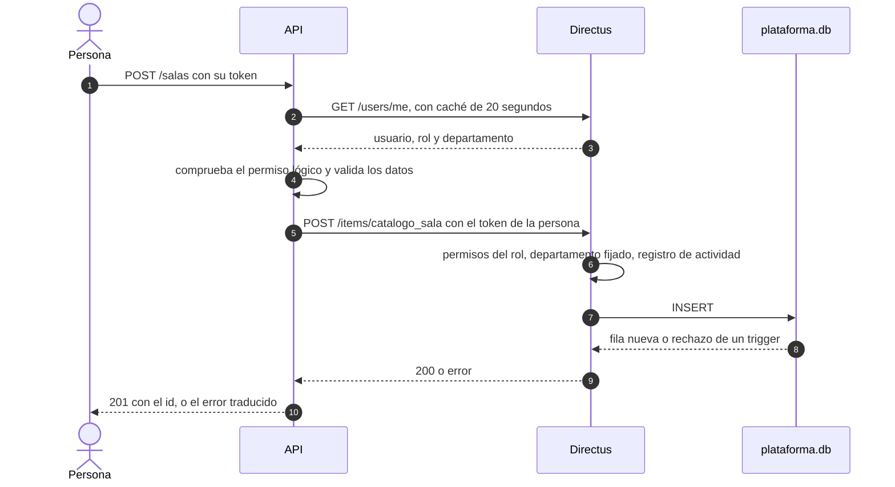
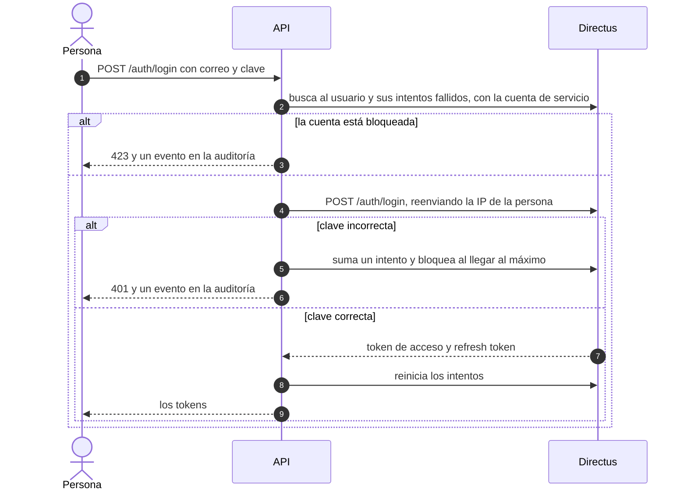

# Base técnica del backend

Todo el sistema usa SQLite, y **Directus es la única puerta a los datos**. La API (FastAPI) no abre el archivo `plataforma.db`: le habla a Directus con la sesión de cada persona, y Directus aplica los permisos por rol y departamento y registra quién cambió qué. El esquema vive en `db/esquema_plataforma.sql` y se genera con `db/generar_esquema.py`.



## Levantarlo

```bash
python3 scripts/configure.py            # crea .env con secretos aleatorios (no se sube)
docker compose up --build --wait
docker compose logs configurar          # roles, permisos y verificaciones de Directus
```

| Servicio | Puerto | Qué es |
| --- | --- | --- |
| `migrar` | | Una sola vez: crea `plataforma.db` desde el esquema si no existe |
| `directus` | 8055 | Directus sobre `plataforma.db`. Es lo único que abre ese archivo en funcionamiento normal, para las personas y para los grupos de Proyecto Integrador |
| `configurar` | | Una sola vez: carga roles y permisos, crea usuarios y un rol con token por grupo, publica la copia `pub_*` y falla si alguna verificación no se cumple |
| `api` | 8000 | FastAPI. Arranca cuando `configurar` terminó bien |
| `frontend` | 3000 | Interfaz web (Next.js). Hoy trae la pantalla de inicio de sesión |

El orden es `migrar`, `directus`, `configurar`, `api`, `frontend`. Las claves de los usuarios iniciales salen de `SEED_ADMIN_PASSWORD` y `SEED_TEST_PASSWORD` del `.env`: `encargado.docente@example.com` (rol Administrador, todos los permisos) y `usuario.prueba@example.com` (consulta, solo lectura en el DISC). El departamento DISC es el id 1 y existe siempre.

## Quién abre la base

Solo `migrar` (crear la base), `configurar` (proteger el registro de actividad) y el generador de datos de prueba abren SQLite directamente. La API lee y escribe todo por Directus, incluida la copia `pub_*` que ven los grupos.

## Autenticación

Los tokens los emite Directus. La API agrega lo que Directus no hace.



| Ruta | Qué hace |
| --- | --- |
| `POST /auth/login` | Entrega un token de acceso (10 minutos) y un refresh token (7 días) |
| `POST /auth/refresh` | Rota el refresh token: el anterior se rechaza |
| `POST /auth/logout` | Cierra la sesión. Se envía el `refresh_token`; el token de acceso deja de valer de inmediato en esta API |
| `POST /auth/cambiar-clave` | Exige la clave actual, valida la política y cierra las sesiones renovables |
| `GET /auth/yo` | Perfil, rol y permisos por departamento |

Las claves las guarda Directus (argon2). Tras 5 intentos fallidos la cuenta se bloquea 15 minutos, y hay un límite de 10 intentos por minuto y por IP. Los tiempos y límites se ajustan con variables de entorno (`LOGIN_MAX_ATTEMPTS`, `LOGIN_LOCK_MINUTES`, `LOGIN_RATE_PER_MINUTE`, `ACCESS_TOKEN_TTL`, `REFRESH_TOKEN_TTL`).

Lo que Directus **no** hace, y esta API cubre o deja anotado:

- No cuenta intentos fallidos ni bloquea cuentas: lo hace la API, con campos en el usuario de Directus.
- No invalida el token de acceso al cerrar sesión. La API recuerda los tokens cerrados y los rechaza hasta que vencen. Eso no alcanza a quien llame a Directus directamente.
- Un refresh token ya usado se rechaza, pero no cierra el resto de la sesión como hacía la versión anterior de la API.
- No audita los inicios de sesión fallidos: van a `plataforma_auditoria`.

## Permisos

Cada rol de la plataforma (`administrador`, `encargado_docente`, `consulta`...) es un rol de Directus con una política que el configurador genera desde `identidad_rol_permiso`; ver [matriz_permisos.md](matriz_permisos.md), que se genera y el CI mantiene al día.

- **Departamento.** Cada permiso se limita al departamento del usuario, deducido de las claves foráneas. Al crear, el departamento del usuario se fija solo (preset) y no se puede apuntar a otro (validación). Los roles con `departamentos.ver_otros` no llevan filtro.
- **Lo que cuelga de un periodo** (paralelos, sesiones) hereda su departamento. Directus no puede comprobar al crear que se vea la fila a la que apunta una clave foránea, así que la API lo hace antes de enviar. Quien llame a Directus directamente con su sesión podría saltarse esa comprobación; es un riesgo conocido y acotado.
- **Cambiar los permisos de un rol** se hace con el configurador, no con la API: `docker compose run --rm configurar python -m app.directus_setup rol-permiso dar|quitar ROL PERMISO`.
- **Usuarios.** Se gestionan por la API con una cuenta de servicio que solo puede crear y modificar usuarios con roles de la plataforma, nunca borrarlos ni dar el rol Administrator de Directus. Cada persona tiene un solo rol y un solo departamento (`departamento_id` vacío = todos).
- **Errores.** Directus oculta el detalle de los rechazos de la base a quien no es administrador. La API explica las reglas más comunes antes de enviar (por ejemplo por qué no se puede aprobar un horario) y, si no, responde 409 con un mensaje general. Los triggers del esquema siguen siendo la red de seguridad.

## Auditoría

- **Cambios de datos e inicios de sesión exitosos:** los registra Directus en `directus_activity` y `directus_revisions`, con usuario, IP (la real de la persona, que la API reenvía) y fecha. El configurador crea triggers que impiden modificar el registro y borrar lo de menos de 5 años.
- **Eventos que Directus no ve:** intentos fallidos, accesos denegados, cambios de permisos, lectura de datos personales, importaciones y publicaciones van a `plataforma_auditoria`, que es de solo inserción y se conserva 5 años.

## Borrado lógico

La API nunca emite `DELETE` sobre el núcleo: `DELETE /salas/1` actualiza `eliminado_en` y `eliminado_por`, y Directus oculta esas filas. Los roles no tienen permiso de borrar (salvo las asignaciones de un borrador), y un `DELETE` real, incluso del administrador de arranque, lo rechaza un trigger.

## Datos personales cifrados

La base **no está cifrada completa**: Directus trae un SQLite sin SQLCipher (sqlite3 5.1.7 sobre SQLite 3.44.2, sin códec; se comprobó con `PRAGMA cipher_version`, que no devuelve nada), y con una clave configurada simplemente la ignoraría y no cifraría. Por eso se cifran a nivel de columna, desde la API, solo el RUT y el correo.

| Dato | Dónde | Cómo se guarda |
| --- | --- | --- |
| RUT de una persona | `catalogo_persona.rut_cifrado` | AES-256-GCM con nonce aleatorio, formato `v1:<clave>:<datos>` |
| Búsqueda y unicidad del RUT | `catalogo_persona.rut_indice` | HMAC-SHA256 del RUT normalizado con `INDEX_KEY`, distinta de las claves de cifrado |
| Correo de una persona | `catalogo_persona.email_cifrado` | Igual que el RUT |
| Correo de un envío de horario | `horarios_envio_horario.email_destino_cifrado` | Igual |
| RUT y correo de las filas crudas de una importación | `plataforma_fila_importada.datos` | Cifrados columna por columna |

- El RUT no es clave en ninguna tabla. Todas apuntan a `catalogo_persona.id`, y la unicidad la da el índice ciego.
- Cada texto cifrado lleva su columna como dato autenticado, así que uno copiado a otra columna no se descifra. Un dato alterado se rechaza.
- Los CHECK del esquema impiden guardar en claro: un RUT o correo sin el prefijo `v1:` no entra. Directus, su registro de actividad y sus revisiones solo ven texto cifrado, y la auditoría nunca lleva el RUT.
- El dígito verificador lo validan la API y el importador, que explican cuál debería ser.
- `DATA_KEYS` (`k1=...,k2=...`, con `DATA_KEY_ID` para la que cifra) e `INDEX_KEY` son claves de 32 bytes en base64 que genera `scripts/configure.py`. **Respáldelas aparte de la base: sin ellas los datos cifrados no se recuperan.** Para rotar, agregue la clave nueva, cambie `DATA_KEY_ID`, reinicie y ejecute `docker compose run --rm configurar python -m app.rotar_claves`. Cambiar `INDEX_KEY` obliga a recalcular los índices.
- Lo que **no** se cifra: el nombre de las personas, los correos de inicio de sesión (`directus_users`) y el resto de la base. Para proteger el archivo completo hay que cifrar el volumen o el disco del servidor, y para el transporte poner un proxy con HTTPS delante.

## Documentación de la API y CORS

La API se documenta sola desde el código: `/docs` (Swagger), `/redoc` y `/openapi.json`. Cada operación tiene resumen, descripción con el permiso que exige y sus respuestas de error, y las pruebas fallan si alguna queda sin documentar. Para llamar a rutas protegidas en Swagger, use *Authorize* con el token de acceso.

El navegador solo puede llamar a la API desde los orígenes de `CORS_ORIGINS` (por defecto `http://localhost:3000`, separados por comas; no se admite `*`). Sin orígenes configurados no se habilita CORS. Los tokens van en el encabezado `Authorization`, no en cookies, así que CORS no admite credenciales.

## Módulos

`MODULES=base,financiero,predictivo` decide qué routers se montan. Cada módulo tiene router, servicio, esquemas y repositorio, y todos comparten `app/core` para el cliente de Directus, la autenticación y la auditoría.

| Módulo | Contenido |
| --- | --- |
| `base` | Identidad (usuarios y roles), catálogo, horarios, importación y publicación para satélites |
| `financiero` | Tarifas, presupuestos, escenarios y nombramientos |
| `predictivo` | Solo el esqueleto, `GET /proyeccion/estado` |

## Satélites

Los grupos de Proyecto Integrador usan el mismo Directus y el mismo archivo que el núcleo, y se separan por permisos y por tablas, no por instancia.

- **Tablas.** `pub_*` es una copia derivada (catálogo del DISC y horario de la propuesta aprobada) y cada grupo tiene `sat_<grupo>_registro` (`sat_g1_registro` a `sat_g4_registro`, con borrado lógico por trigger).
- **Publicación.** `python -m app.publicacion` o `POST /publicacion` (permiso `horarios.exportar`) regenera `pub_*` por Directus con la cuenta de servicio, que lee el núcleo sin ver personas, docentes, nombramientos, finanzas ni auditoría. Directus es atómico por colección, no entre colecciones: durante una publicación un grupo podría ver una tabla ya nueva junto a otra vieja, y basta con repetir la lectura.
- **Permisos de cada grupo (`g1` a `g4`).** Un rol y un token estático (`SAT_TOKEN_G1` a `G4` del `.env`). Lee `pub_*`, y solo escribe en su colección, con borrado lógico y sin permiso de `DELETE`. No ve el núcleo, ni usuarios, ni roles, ni la colección de otro grupo, y su rol no es de la plataforma, así que no puede iniciar sesión como persona en la API. El configurador lo comprueba contra el Directus real.
- **Compartir archivo tiene un costo.** Un fallo de configuración de permisos expondría el núcleo a los grupos, y el registro de actividad queda en el mismo lugar. Por eso las pruebas de integración y el paso `verificar` revisan que un grupo reciba 403 en todo lo que no es suyo.
- **Límite de peticiones.** Directus limita por IP, y como la API concentra a todas las personas en una sola IP, el límite está desactivado. Los módulos de los grupos **no** tienen un límite de peticiones hoy. Si se necesita, hay que ponerlo en un proxy delante.
- `ejemplos/modulo_simulado/` es un módulo de ejemplo que usa exactamente este camino. Se levanta con `docker compose --profile demo up --build` y sirve de modelo para los grupos.
- Para más colecciones de un grupo se crean con el prefijo `sat_<grupo>_`, se agregan al esquema y a `permisos_de_grupo` en `directus_matriz.py`.

## Importación

Hay una plantilla por colección en `plantillas_importacion/` (CSV y XLSX, con una fila de ejemplo ficticia) y su README con columnas, tipos, reglas y orden de carga. `POST /importaciones/{coleccion}` valida el CSV y, con `?confirmar=true`, lo envía a Directus en una sola petición por colección, que es todo o nada. Cada error dice la fila, la columna, qué falló y cómo corregirlo, y la importación queda registrada en `plataforma_importacion` y en la auditoría. La misma especificación (`backend/app/importacion/spec.py`) genera las plantillas, el README y las reglas de validación.

## Pruebas

| Qué | Dónde | Con qué |
| --- | --- | --- |
| Reglas de integridad del esquema | `db/probar_esquema.py` | SQLite en memoria |
| Lógica de la API | `backend/tests` | Un Directus simulado (`tests/falso.py`); no comprueba permisos |
| Permisos, departamentos, borrado lógico, cifrado y auditoría | `backend/tests_integracion` | El stack real con `docker compose up` |
| Datos de prueba, plantillas y módulo de ejemplo | `datos_prueba`, `plantillas_importacion`, `ejemplos/modulo_simulado` | Pytest |
| Permisos de ambas instancias de Directus | `docker compose logs configurar` | El paso `verificar` del configurador |

```bash
cd backend
python -m pytest -q tests ../datos_prueba/test_datos.py ../plantillas_importacion/test_validar.py ../ejemplos/modulo_simulado/test_modulo.py
python -m pytest -q tests_integracion        # con el stack arriba y LOGIN_RATE_PER_MINUTE alto en el .env
```

## Datos de prueba

`datos_prueba/generar_datos.py` genera datos ficticios y reproducibles (semilla fija) para probar y demostrar, y `datos_prueba/DATOS_DE_PRUEBA.md` explica qué hay, cómo se generaron y el rango de RUT ficticios. Nunca se usan datos reales en el repositorio.

## Límites conocidos y pendiente

- El administrador de arranque de Directus es una cuenta de emergencia: puede escribir sin pasar por la API. Sus cambios quedan en el registro de actividad con su usuario.
- Si Directus cae, la API responde 503 y los módulos de los grupos también quedan sin servicio.
- Los módulos de los grupos no tienen límite de peticiones (ver Satélites).
- Un usuario tiene un solo rol y un solo departamento.
- Los módulos de corridas de FET y de cálculo de costos todavía solo tienen sus datos y permisos.
- Autenticación institucional para Directus.
