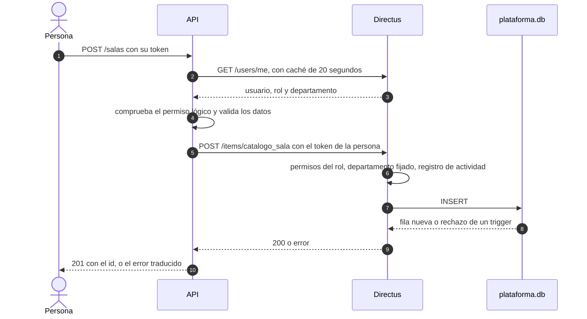

# Arquitectura
Todo el sistema usa SQLite, y **Directus es la única puerta a los datos**. La API (FastAPI) no abre el archivo `plataforma.db`: le habla a Directus con la sesión de cada persona, y Directus aplica los permisos por rol y departamento y registra quién cambió qué. El esquema vive en `db/esquema_plataforma.sql` y se genera con `db/generar_esquema.py`.

## Quién abre la base

Solo `migrar` (crear la base), `configurar` (proteger el registro de actividad) y el generador de datos de prueba abren SQLite directamente. La API lee y escribe todo por Directus, incluida la copia `pub_*` que ven los grupos.

## Módulos

`MODULES=base,financiero,predictivo` decide qué routers se montan. Cada módulo tiene router, servicio, esquemas y repositorio, y todos comparten `app/core` para el cliente de Directus, la autenticación y la auditoría.

| Módulo | Contenido |
| --- | --- |
| `base` | Identidad (usuarios y roles), catálogo, horarios, importación y publicación para satélites |
| `financiero` | Tarifas, presupuestos, escenarios y nombramientos |
| `predictivo` | Solo el esqueleto, `GET /proyeccion/estado` |

Detalle de cada parte: [Autenticación](Autenticacion.md), [Permisos](Permisos.md), [Auditoría y datos personales](Auditoria-y-datos-personales.md) y [Satélites](Satelites.md).
