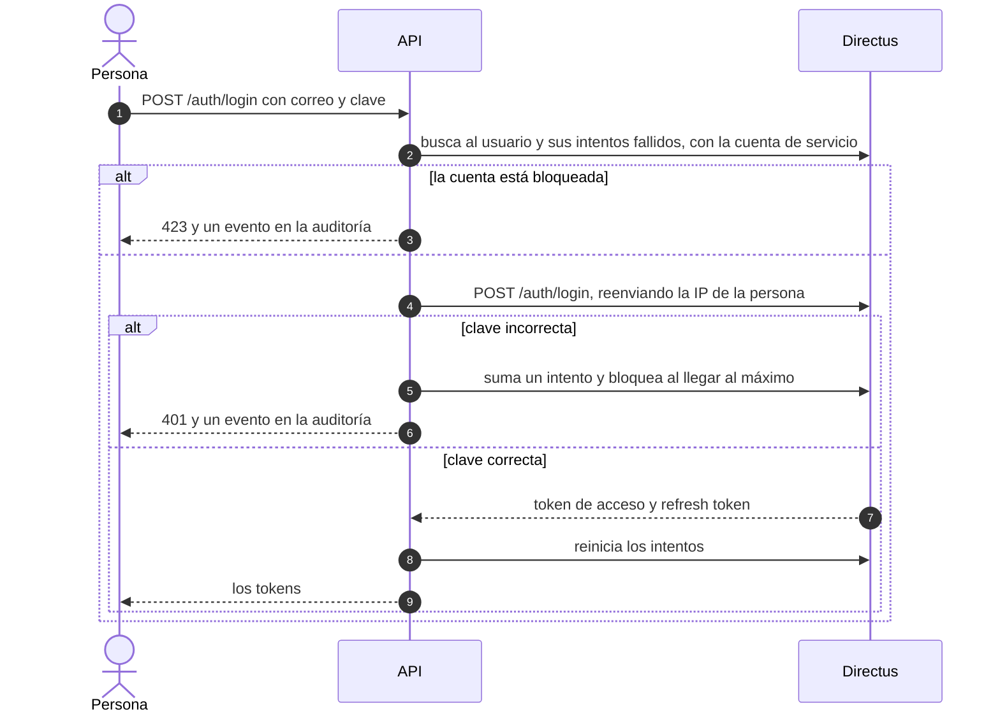

# Autenticación

Los tokens los emite Directus. La API agrega lo que Directus no hace.

| Ruta | Qué hace |
| --- | --- |
| `POST /auth/login` | Entrega un token de acceso (10 minutos) y un refresh token (7 días) |
| `POST /auth/refresh` | Rota el refresh token: el anterior se rechaza |
| `POST /auth/logout` | Cierra la sesión. Se envía el `refresh_token`; el token de acceso deja de valer de inmediato en esta API |
| `POST /auth/cambiar-clave` | Exige la clave actual, valida la política y cierra las sesiones renovables |
| `GET /auth/yo` | Perfil, rol y permisos por departamento |

Las claves las guarda Directus (argon2). Tras 5 intentos fallidos la cuenta se bloquea 15 minutos, y hay un límite de 10 intentos por minuto y por IP. Los tiempos y límites se ajustan con variables de entorno (`LOGIN_MAX_ATTEMPTS`, `LOGIN_LOCK_MINUTES`, `LOGIN_RATE_PER_MINUTE`, `ACCESS_TOKEN_TTL`, `REFRESH_TOKEN_TTL`).

Lo que Directus **no** hace, y esta API cubre o deja anotado:

- No cuenta intentos fallidos ni bloquea cuentas: lo hace la API, con campos en el usuario de Directus.
- No invalida el token de acceso al cerrar sesión. La API recuerda los tokens cerrados y los rechaza hasta que vencen. Eso no alcanza a quien llame a Directus directamente.
- Un refresh token ya usado se rechaza, pero no cierra el resto de la sesión.
- No audita los inicios de sesión fallidos: van a `plataforma_auditoria`.
