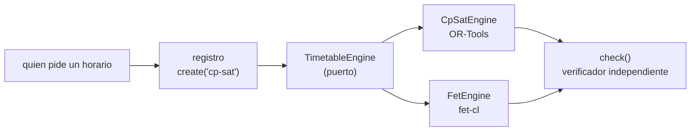

# Motores de horarios

La plataforma puede generar horarios con más de un motor. Hoy hay dos: **FET** (heurístico, rápido, no demuestra que el resultado sea el mejor) y **OR-Tools CP-SAT** (exacto, entrega el mejor horario o la cota que alcanzó en el tiempo dado). Ambos están detrás de un mismo contrato, así que el resto del sistema no sabe cuál usa.

El código está en `backend/app/motores/`.

## Cómo funciona

| Pieza | Archivo | Qué hace |
| --- | --- | --- |
| Modelo neutral | `model.py` | `TimetableProblem` (días, bloques, salas, actividades, disponibilidad de docentes, corte de almuerzo) y `Solution`. No menciona ningún motor |
| Puerto | `port.py` | `TimetableEngine`: lo que todo motor implementa (`availability` y `_solve`). Su método `solve` valida, mide el tiempo, convierte los fallos en un resultado `ERROR` y verifica la solución |
| Adaptadores | `cpsat.py`, `fet.py` | Traducen el modelo neutral a cada motor y devuelven las ubicaciones |
| Verificador | `check.py` | Revisa cualquier solución contra el problema: choques de docente, sala y grupo, capacidad, bloques y almuerzo. No confía en el motor |
| Registro | `registry.py` | `create("cp-sat")`, `names()` y `availability()`. Quien pide un horario no importa los adaptadores |

Los dominios candidatos (en qué bloques puede empezar una actividad y en qué salas cabe) se calculan una sola vez en el modelo, y los dos motores reciben el mismo problema reducido.

## Estados y costo

| Estado | Significado |
| --- | --- |
| `optimal` | Horario válido y demostrado como el mejor para el costo común |
| `feasible` | Horario válido, sin demostración de que sea el mejor (siempre el caso de FET) |
| `infeasible` | No existe un horario con esas reglas, o no se encontró en el tiempo dado; la nota dice por qué |
| `unavailable` | El motor no está instalado en este entorno |
| `error` | El motor falló; la nota dice el tipo de error |

El **costo común** se mide fuera de los motores (`cost()` en `model.py`): cada sesión que empieza en un bloque tardío suma su peso. Así se comparan con la misma vara aunque cada motor optimice a su manera. Toda solución pasa por `check()`, y `Solution.valid` solo es verdadero si no hay violaciones.

## Dependencias

| Motor | Qué necesita | Dónde queda |
| --- | --- | --- |
| CP-SAT | `ortools` (fijado en `backend/requirements.txt`) | Se instala con pip |
| FET | El binario `fet-cl` 7.10.5 | La imagen de la API lo descarga con su suma de verificación a `/opt/fet`. Fuera de Docker se indica con la variable `FET_CL` o se deja en el `PATH` |

Si falta alguno, la API arranca igual: `availability()` informa que ese motor no está disponible y `solve()` devuelve `unavailable` en vez de fallar. El CI instala `fet-cl` para ejecutar también las pruebas de FET.

## Agregar un motor

1. Crear `backend/app/motores/<motor>.py` con una clase que herede de `TimetableEngine`, con `name`, `family`, `availability()` y `_solve()`. Dentro, traducir `TimetableProblem` al formato del motor y devolver un `Solution` con las ubicaciones.
2. Registrarlo con una línea en `registry.py`.
3. Las pruebas de `backend/tests/test_motores.py` le exigen lo mismo que a los demás: que su solución pase el verificador.

Si el motor no puede convivir con otro en el mismo proceso (pasa con OR-Tools y HiGHS), el adaptador debe ejecutarlo en un proceso hijo, como ya hace FET.

## Límites actuales

- El modelo trae las reglas duras básicas (sin choques, capacidad, disponibilidad del docente, almuerzo) y un costo por sesiones tardías. Las reglas del ERS y los pesos del encargado docente se agregan sobre este modelo cuando se validen.
- FET no minimiza el costo común: entrega un horario válido, no el mejor.
- Los motores son síncronos y pueden tardar hasta el tiempo límite. Cuando se expongan por la API deben correr fuera del hilo de la petición.
- La imagen de la API pesa bastante más con `ortools` (incluye numpy y pandas).
